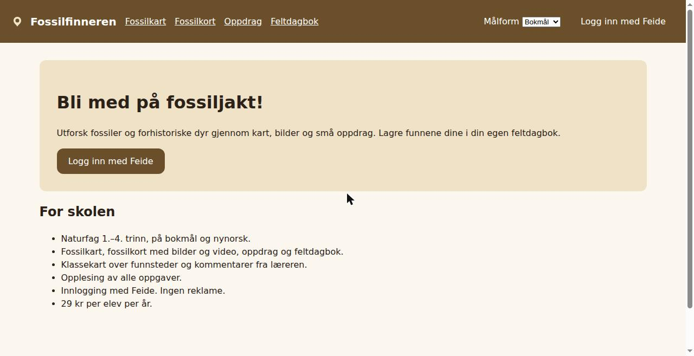
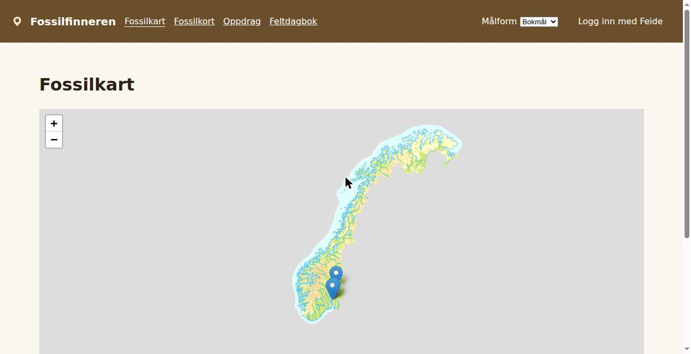
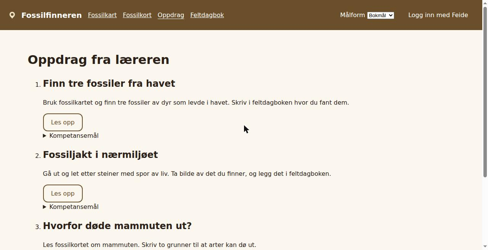

# Fossilfinneren

Fossilfinneren lar elevene utforske fossiler og forhistoriske dyr gjennom kart, bilder og små oppdrag. Elevene lagrer funn i en egen feltdagbok.

Tjenesten er laget for naturfag på 1.–4. trinn. Elevene leter etter fossiler på et kart over Norge, ser på bilder og korte videoer av funnene, løser oppdrag og skriver og fotograferer i feltdagboken sin. Læreren setter opp oppdrag for klassen, ser klassekartet over funnsteder og gir korte kommentarer til elevene.

- **Leverandør:** Fossilfinneren AS, org.nr. 317 280 297
- **Nettside:** https://fossilfinneren.no
- **Innlogging:** Feide (https://fossilfinneren.no/logg-inn)
- **Personvern:** https://fossilfinneren.no/personvern · personvern@fossilfinneren.example

## Skjermbilder

| Forside | Fossilkart | Oppdrag |
| ------- | ---------- | ------- |
|  |  |  |

## Funksjoner

- **Fossilkart** – kart over funnsteder i Norge, med kartdata fra Kartverket.
- **Fossilkort** – bilder, korte videoer og fakta om fossiler og forhistoriske dyr.
- **Oppdrag** – små oppgaver læreren gir klassen, for eksempel «Finn tre fossiler fra havet».
- **Feltdagbok** – eleven skriver fritekst og legger ved bilder av egne funn.
- **Fritekstkommentarer fra lærer** – læreren gir korte kommentarer på elevenes funn.
- **Klassekart over funnsteder** – læreren ser funnene til hele klassen på ett kart.
- **Opplesing av alle oppgaver** – alle oppgaver og fossilkort kan leses opp.

Tjenesten har ikke reklame, bruker ikke kunstig intelligens og er ikke adaptiv.

## Fag, trinn og tema

| Fagkode | Fag og trinn          |
| ------- | --------------------- |
| NAT0001 | Naturfag 1. årstrinn  |
| NAT0002 | Naturfag 2. årstrinn  |
| NAT0003 | Naturfag 3. årstrinn  |
| NAT0004 | Naturfag 4. årstrinn  |

**Tema:** fossiler, dinosaurer, arter som dør ut.

Kompetansemålene tjenesten støtter, står i [docs/laereplan.md](docs/laereplan.md).

## Plattformer og språk

- **Plattform:** nettleser. Tjenesten er en webapplikasjon og krever ingen installasjon.
- **Målform:** bokmål og nynorsk, til samme tid og pris.

## Lisens og pris

29 kr per elev per år. Se [docs/lisens-og-priser.md](docs/lisens-og-priser.md).

## Feide-integrasjon

Tjenesten logger inn brukerne med Feide (OpenID Connect).

- **Omdirigeringsadresse (redirect URI):** `https://fossilfinneren.no/auth/callback`
- **Utloggingsadresse:** `https://fossilfinneren.no/`
- **Brukerinformasjon:** navn, brukeridentifikatorer hos organisasjonen, organisasjonstilhørighet og gruppetilhørigheter for undervisning.

Hvorfor tjenesten trenger hver opplysning, står i [docs/feide-integrasjon.md](docs/feide-integrasjon.md).

## Nettadresser tjenesten bruker

Skolene må åpne disse adressene i innholdsfilteret sitt:

| Adresse                   | Brukes til                             |
| ------------------------- | -------------------------------------- |
| fossilfinneren.no         | Selve tjenesten                        |
| cdn.fossilfinneren.no     | JavaScript, stilark og ikoner          |
| api.fossilfinneren.no     | API                                    |
| innhold.fossilfinneren.no | Bilder og innhold til fossilkortene    |
| video.fossilfinneren.no   | Korte videoer om fossiler              |
| auth.dataporten.no        | Feide-innlogging                       |
| api.dataporten.no         | Brukerinformasjon fra Feide            |
| groups-api.dataporten.no  | Skole og klasser fra Feide             |
| cache.kartverket.no       | Kartfliser fra Kartverket              |
| plausible.io              | Anonym besøksstatistikk (se under)     |

Den fullstendige listen står i Content-Security-Policy i [apps/web/nginx.conf](apps/web/nginx.conf).

## Underleverandører

| Underleverandør                | Land | Behandler                         |
| ------------------------------ | ---- | --------------------------------- |
| Wolkenhafen Rechenzentrum GmbH | DE   | Drift og lagring                  |
| Liffey Mailworks Ltd           | IE   | Utsending av e-post               |
| Plausible Insights OÜ          | EE   | Anonym besøksstatistikk           |

All behandling skjer innenfor EU/EØS. Detaljer i [docs/underleverandorer.md](docs/underleverandorer.md).

## Universell utforming

Tjenesten er **delvis i samsvar** med kravene (WCAG 2.1 nivå AA). Kjente avvik:

- **1.1.1 Ikke-tekstlig innhold** – noen bilder i fossilkortene mangler tekstalternativ.
- **2.4.7 Synlig fokus** – fokus er ikke synlig på knappene i fossilkartet.

Tilgjengelighetserklæringen ligger på UU-status: https://uustatus.no/nb/erklaringar/fossilfinneren-elev. Se også [docs/tilgjengelighetserklaering.md](docs/tilgjengelighetserklaering.md).

## Dokumentasjon

- [Personvernerklæring](docs/personvernerklaering.md)
- [Informasjonskapsler](docs/informasjonskapsler.md)
- [Databehandleravtale](docs/databehandleravtale.md)
- [Leverandørerklæring om informasjonssikkerhet og personvern](docs/leverandorerklaering.md)
- [Arkitektur og dataflyt](docs/arkitektur.md)
- [Sikkerhet](SECURITY.md)

## Utvikling

Krever Node 24, pnpm 12 og Docker.

```sh
cp .env.example .env
docker compose up -d postgres
pnpm install
pnpm db:migrate
pnpm dev            # web på http://localhost:5173, API på http://localhost:4000
```

Lokalt kan du logge inn uten Feide med `VITE_AUTH_MODE=mock` (standard i `.env.example`). Testbrukerne er hentet fra Feides testorganisasjon.

```sh
pnpm lint
pnpm typecheck
pnpm test
pnpm test:a11y      # axe-tester med Playwright
pnpm build
```

## Drift

Tjenesten kjører i Kubernetes hos Wolkenhafen Rechenzentrum i Hamburg. Manifestene ligger i [deploy/k8s](deploy/k8s).

---

Fossilfinneren AS er en fiktiv leverandør, laget som demotjeneste for Læringsplatformen. Organisasjonsnummeret og domenet finnes ikke.
